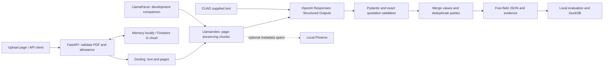

# Document Intelligence Pipeline

A Python portfolio pilot that extracts five commercial-contract fields from PDFs: document name, parties, agreement date, effective date, and governing law. Each field includes a status and source quotations. PDF evidence carries parser-provided page numbers and page-relative character offsets.

**Status:** local FastAPI API and upload UI work. The final pilot benchmark is in [reports/held_out.md](reports/held_out.md). Cloud deployment and Docker validation remain pending; this repository does not claim a live production service.

## Try it locally (Windows / PowerShell)

The development environment was tested with Python 3.14; the unverified container targets Python 3.12. Docling/PyTorch installation and the first model download can take time and disk space.

```powershell
py -m venv .venv
.\.venv\Scripts\python.exe -m pip install -r requirements.txt
Copy-Item .env.example .env
# Edit .env locally and set OPENAI_API_KEY. Never paste a key into chat or Git.
.\.venv\Scripts\python.exe -m uvicorn app.api:app --host 127.0.0.1 --port 8080
```

Open **http://127.0.0.1:8080**. Upload [examples/sample_agreement.pdf](examples/sample_agreement.pdf), wait for extraction, and download the JSON. The UI and API use the same code. A saved real extraction is in [examples/sample_result.json](examples/sample_result.json); the sample is synthetic and safe to share. Live extraction uses a paid OpenAI API call.

```powershell
Invoke-RestMethod http://127.0.0.1:8080/health
curl.exe -sS http://127.0.0.1:8080/extract -F "file=@examples/sample_agreement.pdf;type=application/pdf" -o outputs/my_result.json
```

Create `outputs` first if it does not exist: `New-Item -ItemType Directory -Force outputs`.

The private pilot accepts only 21 SHA-256-listed PDFs: 20 development contracts plus the synthetic example. Arbitrary customer contracts and test PDFs are intentionally outside the upload allowlist. A wrong file type returns 415; an oversized file returns 413; an unlisted PDF returns 422. Monthly budget exhaustion returns 429; unavailable usage storage returns 503. Refused, incomplete, and failed model outputs remain explicit in the response.

## Architecture



Structured Outputs constrains JSON structure; it does not prove that a fact is correct. Pydantic checks the shape, evidence validation checks that quotations exist, and evaluation checks values against reviewed labels. A source-backed quotation can still support an incorrectly interpreted fact.

Dates use ISO `YYYY-MM-DD` strings when unambiguous, not Unix timestamps: a calendar date has no known time or timezone. Conditional or incomplete dates return `ambiguous` with evidence. CUAD supplied text has no invented page references.

## Reproduce the pilot

Download CUAD from the [Atticus Project](https://www.atticusprojectai.org/cuad/) and place the official `train_separate_questions.json` and `test.json` in `data/raw/cuad_benchmark/`. Keep the supplied manifests; regenerating them would change the experiment. Raw contracts, keys, and operational outputs are Git-ignored.

```powershell
.\.venv\Scripts\python.exe scripts\validate_manifests.py
.\.venv\Scripts\python.exe -m unittest discover -s tests
.\.venv\Scripts\python.exe -m scripts.freeze_pilot --verify-only
```

Read-only freeze verification checks tracked source hashes and configuration without changing the freeze. Creating the original freeze (without `--verify-only`) requires the original development comparison artifact at `outputs/parser_comparison/comparison.json`.

Final evaluation commands (paid calls only for uncached first attempts):

```powershell
.\.venv\Scripts\python.exe -m scripts.download_cuad_pdfs --split held_out --download
.\.venv\Scripts\python.exe -m scripts.run_held_out --mode text
.\.venv\Scripts\python.exe -m scripts.run_held_out --mode pdf
.\.venv\Scripts\python.exe -m scripts.report_held_out
```

Do not use these test results to tune the existing experiment. A future improvement needs a new development experiment and fresh evaluation data. References were agent-reviewed before predictions, not independently adjudicated by a legal expert.

See [DATASET_SELECTION.md](DATASET_SELECTION.md), [FIELD_MAPPING.md](FIELD_MAPPING.md), [EVALUATION.md](EVALUATION.md), and [MILESTONE5.md](MILESTONE5.md) for selection, scoring, and parser comparison. Raw runs and page parses remain under `outputs/held_out/`; DuckDB analytics remain local in `data/processed/benchmark.duckdb`.

## Deployment and limits

[MILESTONE6.md](MILESTONE6.md) contains Docker and private Cloud Run instructions. Target region: Mumbai (`asia-south1`). Billing can be enabled later. Use Cloud Run authentication, Secret Manager, and transactional Firestore usage accounting; never rely on local DuckDB for cloud durability. `.gcloudignore` restricts source uploads to runtime files.

Uploaded PDFs are temporary and results are returned without retained cloud storage. Add durable object storage before introducing retained inputs/results. Logs omit document text and exception contents; optional Phoenix traces contain allowlisted metadata only.

The $20 benchmark allowance and estimated $5/month app guard are application controls, not guarantees on provider or cloud bills. The app is synchronous, caps PDFs at 10 MiB, and uses at most 80 chunks. One held-out local PDF took over 20 minutes, exceeding the proposed 900-second cloud timeout. Durable asynchronous jobs are required before claiming that broader workload supported in the cloud, unless a narrower bounded scope is independently validated on the hosted service. No production authentication system, unrestricted customer uploads, vector database, or all-41-category extraction is claimed.

## Walkthrough

Watch the [48-second captioned walkthrough](examples/pilot_walkthrough.mp4), an explanatory slideshow using the saved synthetic result (not a live screen recording). Use [DEMO.md](DEMO.md) for a live presentation and [LEARNING_LOG.md](LEARNING_LOG.md) to revise the implementation steps. The central Python concepts are typed Pydantic models (like validated PHP DTOs), `Path` for filesystem work, adapters for parser interchangeability, and explicit run records for reproducible experiments.
